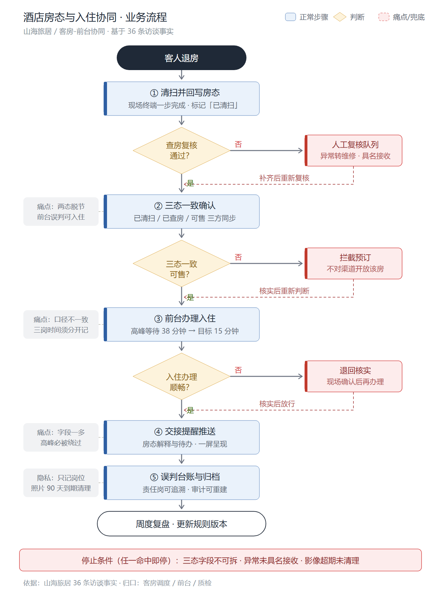
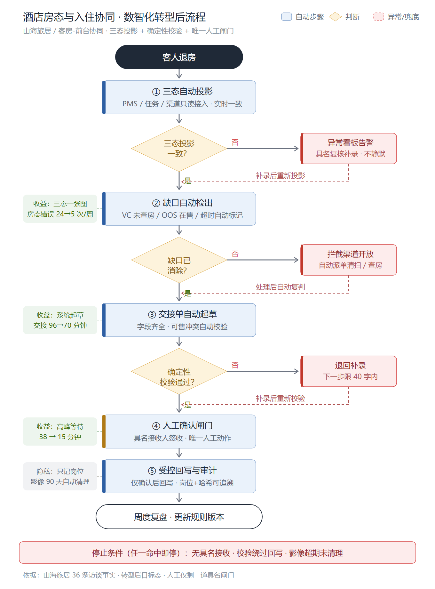

# 流程图

两组流程图对比「现状」与「数智化转型后」的酒店房态与入住协同业务流程。每组提供 SVG（矢量，可编辑）与 PNG（2 倍分辨率）两种格式。

## 现状 · 业务流程图

- 文件：[现状-业务流程图.svg](现状-业务流程图.svg) / [现状-业务流程图.png](现状-业务流程图.png)
- 主线：客人退房 → ① 清扫并回写房态 → ② 三态一致确认 → ③ 前台办理入住 → ④ 交接提醒推送 → ⑤ 误判台账与归档 → 周度复盘
- 三处判断（查房复核 / 三态一致可售 / 入住办理顺畅），每处带右侧兜底分支与虚线回退
- 左侧灰框标注现状痛点：两态脱节、口径不一致、字段多被绕过、隐私约束
- 底部为停止条件：三态字段不可拆、异常未具名接收、影像超期未清理

## 数智化转型后 · 业务流程图

- 文件：[数智化转型后-业务流程图.svg](数智化转型后-业务流程图.svg) / [数智化转型后-业务流程图.png](数智化转型后-业务流程图.png)
- 主线：客人退房 → ① 三态自动投影 → ② 缺口自动检出 → ③ 交接单自动起草 → ④ 人工确认闸门（唯一人工动作）→ ⑤ 受控回写与审计 → 周度复盘
- 三处判断改为系统确定性判定：投影一致性、缺口消除、校验通过；异常走看板告警与自动派单
- 左侧绿框标注转型收益：口径误差 4→0 次/周、交接 96→70 分钟、高峰等待 38→5 分钟
- 关键设计不变：异常必须具名接收、仅确认后回写、影像 90 天自动清理

## 对比要点

| 维度 | 现状 | 数智化转型后 |
| --- | --- | --- |
| 三态同步 | 人工口头/终端分头回写 | 只读接口自动投影，实时一致 |
| 异常发现 | 事后对账，靠人记忆 | 缺口自动检出，看板告警 |
| 交接单 | 高峰被绕过 | 系统起草，字段齐全带校验 |
| 人工动作 | 全程人工 + 反复核实 | 仅剩一道具名确认闸门 |
| 审计 | 台账靠手记 | 岗位 + 哈希，审计可重建 |
