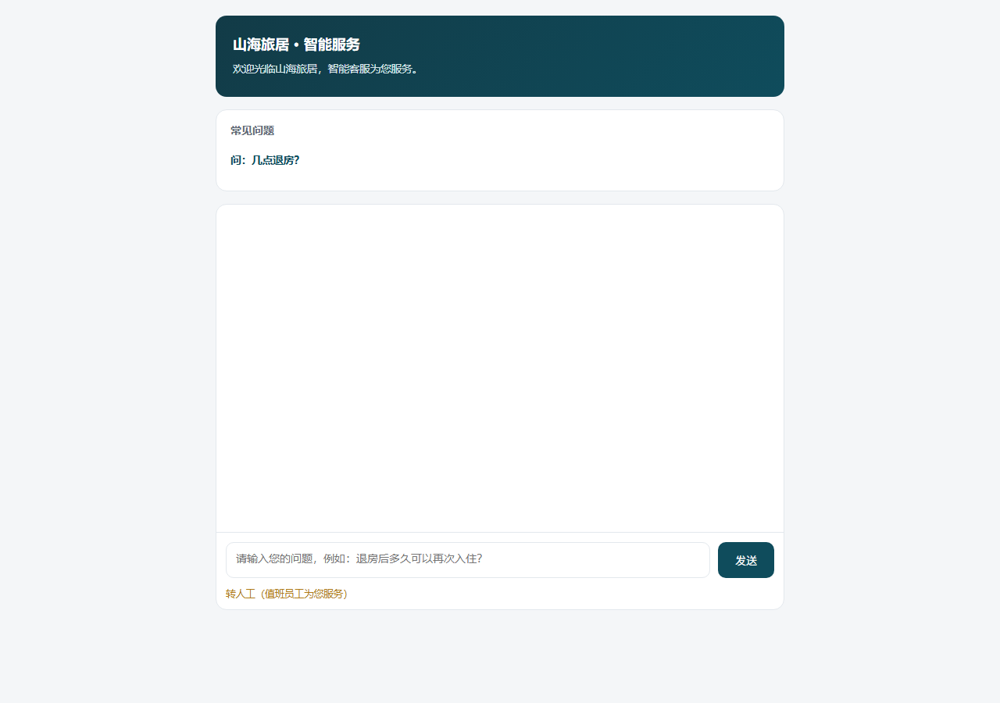

# 酒店问答助手 · 三角色协同版（归档 v1.0.0）

> **归档信息**：v1.0.0 · 归档日期 2026-11-06 · 对应《项目设计方案》V2.0 中「AI 问答与人工兜底」能力演示
> **定位**：山海旅居「酒店房态与入住协同」的可运行演示系统。客人问、AI 答、答不了转人工、管理员可改——一条完整闭环。

FastAPI 异步后端 + Jinja2 服务端渲染 + 原生 JS 前端，无构建步骤。检索层为 BM25 + FAISS 混合检索（RRF 融合），生成层为 OpenAI 兼容流式接口（默认千问 qwen-plus），会话、账号、知识库、提示词、页面文案全部落在 SQLite。未配置模型密钥时自动降级为「检索摘要模式」，功能链路完整可用。



## 三角色与三端入口

服务默认监听 `http://127.0.0.1:8000`。

| 端 | 地址 | 登录方式 | 能做什么 |
| --- | --- | --- | --- |
| 客人端 | `/guest` | 免登录，填房号即入（1–10 位字母数字，如 `1208`） | AI 流式问答、看引用条款、一键转人工、转人工后与员工在同一线程对话、刷新恢复历史 |
| 员工端 | `/staff`（登录后） | `staff` / `Staff@123` | 工单池（待接单/进行中/已完结）、接单、回复、完结、实时对话线程 |
| 管理端 | `/admin`（登录后） | `admin` / `Admin@123` | 知识库增删与重建索引、提示词模板编辑、首页文案编辑、会话审计与违规标记、账号管理 |

登录页 `/login`；根路径 `/` 重定向到客人端。演示口令仅用于本地验收，部署前必须修改并把 `JWT_SECRET` 换成随机长串。

## 快速开始

```bash
cd src/hotel-assistant

# 1. 安装依赖（Python 3.10+）
pip install -r requirements.txt

# 2. 配置模型（可选；不配则走检索摘要模式）
cp .env.example .env        # Windows: copy .env.example .env
# 编辑 .env，填入 LLM_API_KEY / EMBED_API_KEY / JWT_SECRET

# 3. 建库 + 种子账号 + 入库制度文档
python seed.py
python ingest.py            # 生成 rag_index/；换过向量模型需重跑

# 4. 启动
python -m uvicorn app:app --host 127.0.0.1 --port 8000
```

`GET /healthz` 返回 `llm_ready` 与索引状态，可用来判断是否真的接上了大模型。

## 一次完整闭环（5 分钟验收）

1. 打开 `/guest`，填房号 `1208` 进入 → 问「维修房解除封锁需要什么证据」→ 逐字流式回答，底部展开引用卡（应命中制度第七条/第八条）；
2. 追问「那照片要保留多久」→ 验证同会话上下文；
3. 点「转人工」→ 客人侧输入框切换为「留言给值班员工」；
4. 另开窗口用 `staff` 登录 `/staff` → 工单池出现带房号的新工单 → 接单 → 回复；
5. 回到客人窗口 → 5 秒内看到员工回复，客人再发一句 → 员工侧工单线程同步出现；
6. 员工点「完结」→ 客人侧提示会话已结束，全量聊天记录保留在管理端审计页。

管理端验证：`/admin/kb` 上传一份制度 md → 保存即重建索引，回客人端提问立刻按新知识回答；`/admin/prompts` 改提示词 → 下一个问题立即生效（每请求读库，无缓存）；`/admin/audit` 可看到每条消息的房号、角色、违规标记。

## 接口

**鉴权**：`POST /auth/login` · `POST /auth/logout` · `GET /auth/me`（JWT 存 HttpOnly Cookie，8 小时）

**客人端**（免登录，按 `session_id` 区分）

| 接口 | 说明 |
| --- | --- |
| `POST /guest/sessions` | 建房号会话，返回 `guest_session_id` |
| `POST /guest/chat` | AI 问答，SSE：`status → citations → token… → done` |
| `POST /guest/sessions/{sid}/escalate` | 转人工 |
| `POST /guest/sessions/{sid}/say` | **转人工后**直发员工（未转人工会被拦截） |
| `GET /guest/sessions/{sid}/messages` | 历史消息（刷新恢复 / 轮询拉新） |

**员工端**：`GET /staff/tickets` · `GET /staff/tickets/{sid}` · `POST /staff/tickets/{sid}/claim` · `POST /staff/tickets/{sid}/reply` · `POST /staff/tickets/{sid}/resolve`

**管理端**：`/admin/api/kb/docs`（GET/POST/DELETE）、`/admin/api/kb/reindex`、`/admin/api/prompts/default`（GET/PUT/重置）、`/admin/api/pages/home`（GET/PUT）、`/admin/api/audit/messages`（GET + 标记）、`/admin/api/users`（新建/重置口令/停用）

**兼容旧接口**：`/sessions`、`/chat`、`/sessions/{sid}/messages` 保留给单端调用场景。

错误统一 `{"code":…,"message":"中文","detail":null}`。主要错误码：40001 会话不存在 / 40002 参数非法 / 40101 账号或口令错误 / 40301 越权 / 40901 已转人工 / 42901 并发等待 / 50001 LLM 降级 / 50002 检索异常。

## 目录

```
src/hotel-assistant/
├── app.py                  # 入口、全部路由、SSE 包装、统一错误
├── auth.py                 # JWT + PBKDF2 口令 + require_staff/require_admin
├── db.py                   # SQLite（WAL）表结构与全部读写、幂等迁移
├── chat_engine.py          # 问答编排：检索 → 组上下文 → 流式 → 落库 → 违规标记
├── rag.py                  # 索引加载与混合检索封装
├── llm_stream.py           # OpenAI 兼容流式调用 + 降级摘要
├── kb.py                   # 知识库文档增删改与索引重建（多文档分片管理）
├── ingest.py               # 制度文档切片入库
├── rules.py                # 违规关键词确定性标记（四类）
├── seed.py                 # 建表 + 种子账号 + 默认提示词/页面文案
├── templates/              # guest / login / staff / staff_ticket / staff_chat + admin/*
├── static/                 # admin.css（管理端样式）、index.html（旧单页，留档）
├── data/客房管理制度.md      # 示例语料（12 条，v1.2）
└── screenshots/            # 登录页、客人端
```

## 数据与安全

- 全部数据在 `hotel.db`；`rag_index/` 为向量索引；两者与 `.env` 均已 gitignore，不进仓库。
- 口令为 PBKDF2-HMAC-SHA256（12 万轮 + 随机盐）；JWT 放 HttpOnly Cookie，前端 JS 读不到。
- 权限在接口层用依赖校验，越权返回 403 而不是隐藏按钮；管理端页面同样走服务端校验。
- 审计表记录角色、房号、消息原文、违规标记与处理状态，便于事后追溯。
- 客人端只暴露对客口径，提示词已约束禁止输出内部术语（OOO/三态/库存扣除等），引用只允许照抄检索元数据，避免编造条款。

## 已知限制

- 单进程内存锁控制同会话并发，多进程部署需换 Redis 锁；
- 向量索引随文档量线性重建，超过千级切片需换 pgvector / 独立向量库；
- 员工端 10 秒轮询、客人端 3 秒轮询，实时性够演示但非生产级推送；
- 违规识别为关键词规则，属确定性兜底，不替代语义审核。

## 版本

见 [CHANGELOG.md](CHANGELOG.md)。本目录为 v1.0.0 归档快照，后续迭代请另开分支。
