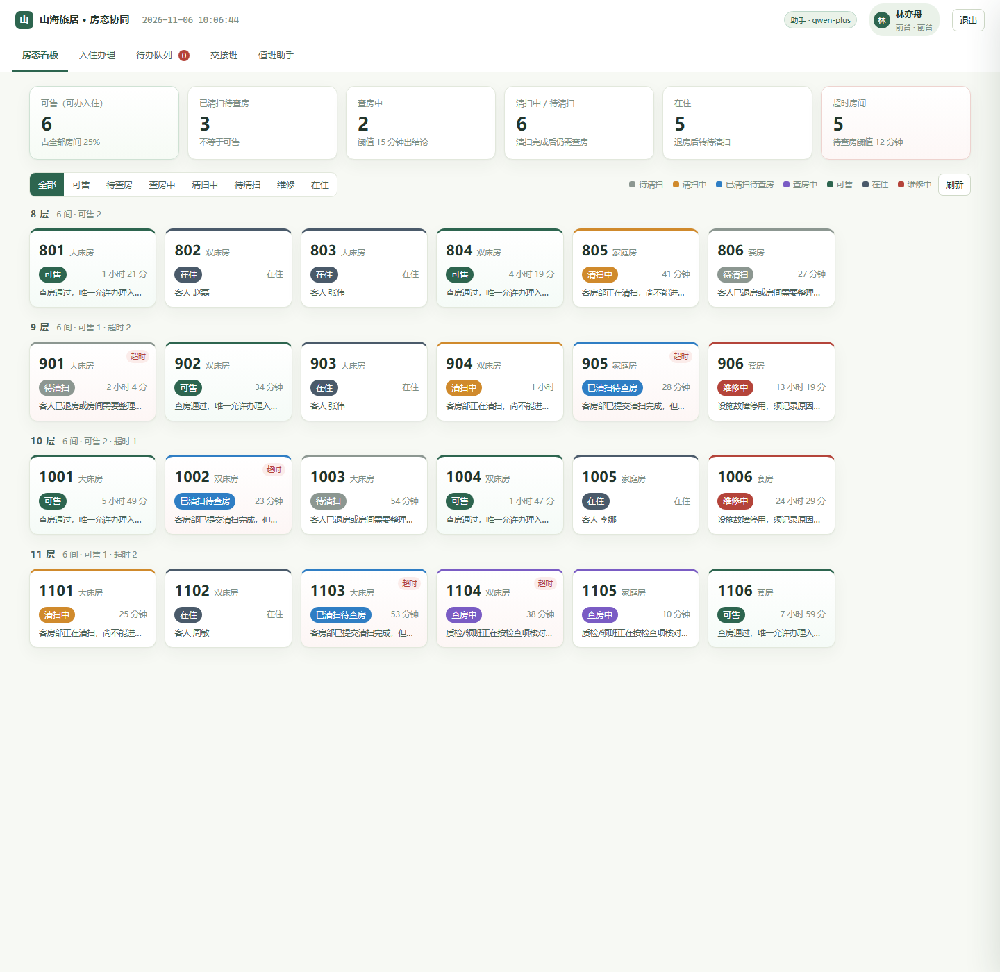
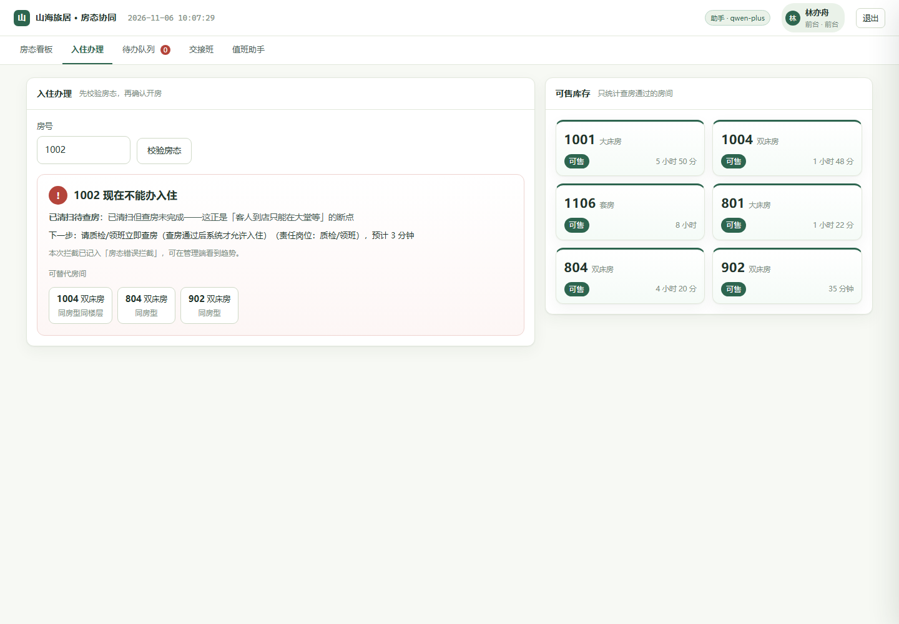
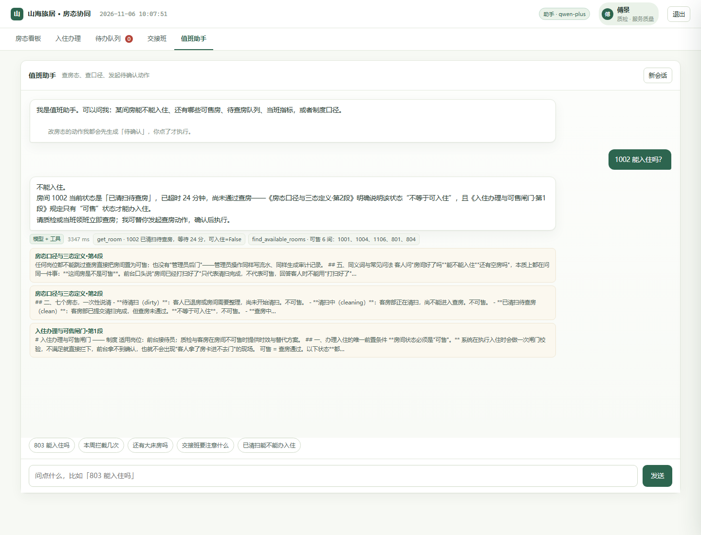
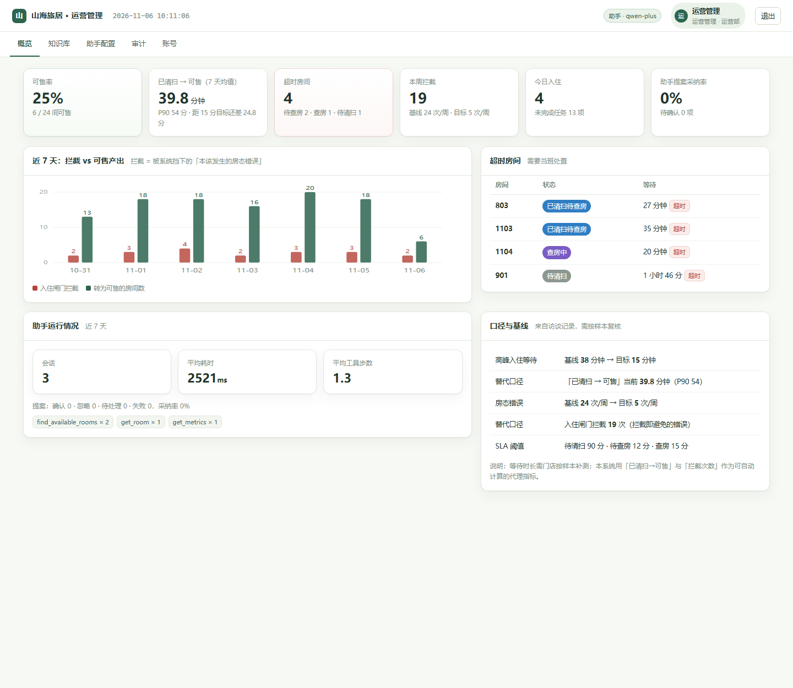

# 山海旅居 · 房态与入住协同 MVP

> **一句话**：把「已清扫」和「可售」拆成两个状态，让前台在开房前就被系统拦一次——拦下的就是原本会发生的房态错误。
>
> 员工端 + 管理端 · 工程架构 + Agent 框架 + 知识库 · 可运行、可测试、可交付。

- 代码基线：`v0.1.0` · 2026-11-06
- 端口：`http://127.0.0.1:8100`（默认）
- 规模：24 间房、7 个房态、10 条受控迁移、11 个 Agent 工具、5 篇制度知识库

## 解决什么问题

访谈里运营经理的描述是这样的：**客房部标了「已清扫」，前台据此以为可入住，但查房还没完成，客人到店后只能在大堂等。**

两个基线指标（访谈记录，待门店按样本复核）：高峰入住等待 38 分钟 → 目标 15 分钟；房态错误 24 次/周 → 目标 5 次/周。

MVP 不试图「用 AI 猜房态」，而是做三件确定的事：

| 动作 | 机制 | 对应指标 |
| --- | --- | --- |
| 口径归一 | 7 个房态、10 条受控迁移，`clean`（已清扫）与 `ready`（可售）强制分离 | 房态错误 |
| 开房前拦截 | 入住闸门：非 `ready` 一律拦下，给出原因、责任岗位、预计时长、替代房 | 房态错误 → 拦截次数 |
| 时效可见 | 每次迁移留事件，算「已清扫 → 可售」均值与 P90，超时标红并进交接摘要 | 入住等待 |

## 角色与权限

| 岗位 | 账号 | 能做什么 | 刻意不能做什么 |
| --- | --- | --- | --- |
| 前台 | `front` / `Front@123` | 看板、办入住、办退房、报修 | 不能改查房结论、不能自己把房间置为可售 |
| 客房 | `house` / `House@123` | 开始清扫、提交已清扫、报修、维修完成 | 不能下查房结论 |
| 质检 | `qa` / `Qa@123` | 发起查房、查房通过 / 不通过 | 不能办入住 |
| 运营 | `admin` / `Admin@123` | 全部 + 知识库、阈值、账号、审计 | — |

**结论权与执行权分开**，是这套权限设计的核心：前台没有「把已清扫改成可售」的按钮，只有「催查房」的路径。

## 界面

| 员工端 · 房态看板 | 员工端 · 入住闸门拦截 |
| --- | --- |
|  |  |
| 24 间房按状态着色，KPI 顶部固定，超时房间标红并置顶 | 1002 是「已清扫待查房」，直接拦下并给出责任岗位、预计时长、替代房 |

| 员工端 · 值班助手 | 管理端 · 概览 |
| --- | --- |
|  |  |
| 真模型（qwen-plus）回答，附工具轨迹（查了哪几个工具、耗时多久）与制度原文片段 | 拦截趋势、时效、超时房间、助手运行情况、口径与基线对照 |

## 快速开始

```bash
cd src/room-status-mvp
pip install -r requirements.txt

cp .env.example .env          # 可选：填 LLM_API_KEY 启用真模型
python -m uvicorn app:app --host 127.0.0.1 --port 8100
```

首次启动自动建库、写入演示数据（24 间房 + 近 7 天房态流水 + 5 篇制度）。

- 员工端：<http://127.0.0.1:8100/staff>
- 管理端：<http://127.0.0.1:8100/admin>
- 健康检查：`GET /healthz`（含 `llm_ready`、知识库片数）

跑测试：

```bash
python -m unittest discover -s tests -v      # 41 项通过，约 40 秒
```

## 五分钟验收

1. `front` 登录 → 看板看到 24 间房，6 种颜色；点 **803**（已清扫待查房）→ 缺少「办理入住」按钮，只有「开始查房」；
2. 直接到「入住办理」输入 `803` → **红色拦截卡**：原因「已清扫但查房未完成」、责任岗位质检、预计时长、替代房 801/1001/804；
3. 换 `qa` 登录 → 803 点「开始查房」→ 再点「查房通过」→ 六个检查项必须全勾，否则只能选「查房不通过」；
4. 回 `front` → 803 变成绿色可售 → 入住办理输入客人姓名 → 开房成功，房态转「在住」；
5. 打开「值班助手」问「803 能入住吗」→ 回答带房态依据；问「已清扫能不能办入住」→ 带制度引用；
6. 对助手说「帮我给 1105 发起查房」→ 生成**待确认动作**，点确认才执行；
7. `admin` 登录 → 概览看拦截趋势与「已清扫→可售」均时；知识库改一段口径 → 回助手提问立刻按新口径答。

## 目录与分层

```
src/room-status-mvp/
├── app.py                 # 入口：路由挂载、页面、启动即播种
├── config.py              # 配置（.env 零依赖加载）
├── core/                  # 工程基座
│   ├── db.py              #   SQLite（WAL）、schema、审计、设置项
│   ├── security.py        #   JWT + PBKDF2 + 岗位权限矩阵
│   ├── errors.py          #   统一错误码与响应
│   └── seed.py            #   演示数据（含 7 天房态流水）
├── domain/                # 业务内核（不依赖 Web 与 LLM）
│   ├── state_machine.py   #   7 状态 / 10 迁移 / 守卫 / 入住闸门
│   └── metrics.py         #   时效、拦截、交接摘要
├── api/                   # 接口层（薄，只做鉴权与参数校验）
│   ├── auth.py  rooms.py  tasks.py  handover.py
│   ├── agent_api.py       #   对话、历史、提案确认/忽略
│   ├── kb_api.py          #   知识库 CRUD 与检索测试
│   └── admin_api.py       #   审计、设置、账号、助手统计
├── agent/                 # Agent 框架
│   ├── runtime.py         #   预取 → 生成 → 校验 三段式
│   ├── tools.py           #   11 个工具（只读执行 / 写操作只提案）
│   └── prompts.py         #   系统提示词（存库、可改、即时生效）
├── kb/                    # 知识库
│   ├── store.py           #   切片、BM25 + 哈希向量、RRF、引用
│   ├── embedder.py        #   中文二元组分词 + 256 维哈希向量
│   └── docs/*.md          #   5 篇制度（口径 / 查房 / 闸门 / 升级 / 异常）
├── templates/             # login / staff / admin 三个页面
├── static/                # style.css、common.js、staff.js、admin.js
├── screenshots/           # 界面快照（README 引用）
├── tests/                 # 41 项单测（19 业务内核 / 5 知识库 / 11 工具 / 6 护栏）
└── docs/ARCHITECTURE.md   # 工程架构、Agent 框架、知识库、边界
```

依赖方向单向向下：`api → domain → core`，`agent → domain + kb`。业务内核 `domain/` 不 import FastAPI，也不 import LLM，因此可以脱离 Web 单测——41 个测试里 19 个跑的是纯业务规则，不需要起服务也不需要模型密钥。

## Agent 框架要点

不是「把问题丢给大模型」，而是**预取 → 生成 → 校验**三段式：

1. **预取**：先用确定性代码查事实（问句里有房号就查房态，问库存就查可售，问指标就查指标，问规则就检索制度），作为【当班数据】【可用制度片段】塞进系统消息；
2. **生成**：模型只负责判断还缺什么（可继续调工具，最多 4 轮）和把结论写成员工听得懂的话；
3. **校验**：引用了不存在的文档、指标数字与工具返回不一致、提到没查过的房号、声称「已执行」却没有生成动作——任一条命中就判不合格，**改用规则答案**并在界面标注 `guarded`。

写操作一律只提案：`propose_*` 工具落一条 `pending` 记录，员工点确认才执行，且执行时再走一遍岗位校验。LLM 再强也改不了房态。

未配置模型密钥时，同一套工具由规则规划器编排，功能完整可用（`mode=fallback`）。

细节见 [docs/ARCHITECTURE.md](docs/ARCHITECTURE.md)。

## 知识库要点

5 篇制度覆盖口径、查房标准、闸门规则、超时升级、异常处置。切片按段落（≤320 字），检索是 **BM25（中文二元组）+ 256 维哈希向量** 双路，RRF 融合。

选型理由：中文短术语（「已清扫」「可售」「查房」）用二元组 BM25 最准；哈希向量补口语化问法；两路都离线、确定性、可回归，不引入 embedding 费用与网络依赖。生产替换点：把 `kb/embedder.py` 的 `embed()` 换成 `text-embedding-v3`，接口不变。

## 数据与隐私

- 全部数据在 `data/mvp.db`，与 `.env` 一起被 gitignore；
- 口令 PBKDF2-HMAC-SHA256（12 万轮 + 随机盐）；JWT 放 HttpOnly Cookie；
- 房态流水、审计、提案不可删除，只能追加说明——用于验收取证；
- 演示数据是造的（`core/seed.py`），页面与文档均标注「演练数据」，不代表真实客户数据。

## 边界（很重要）

来自客户简报的边界约束：**只读核对与人工交接**。

- 系统不自动改房态、不自动放行、不替人下查房结论；
- 助手只做核对与建议，改动一律「提案 + 人工确认」；
- 不承诺收益数字：38 分钟 → 15 分钟是管理层给的**目标**，需门店按节点补测才能验收；本系统提供的是可自动计算的代理指标（已清扫→可售、拦截次数）。
